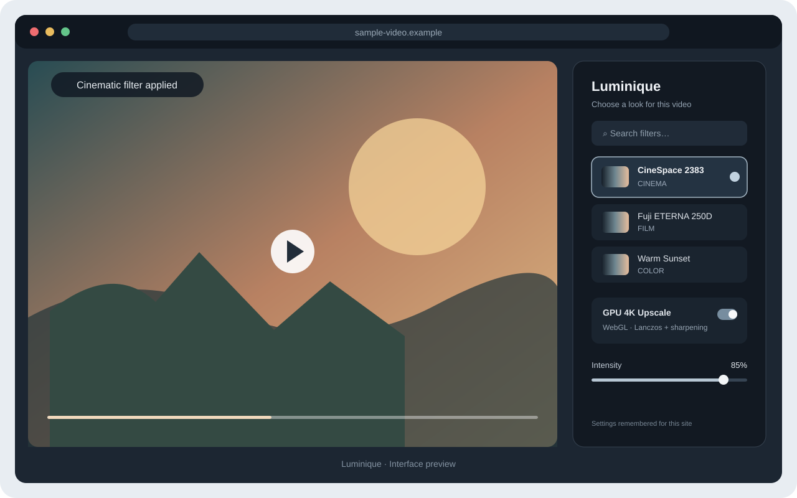
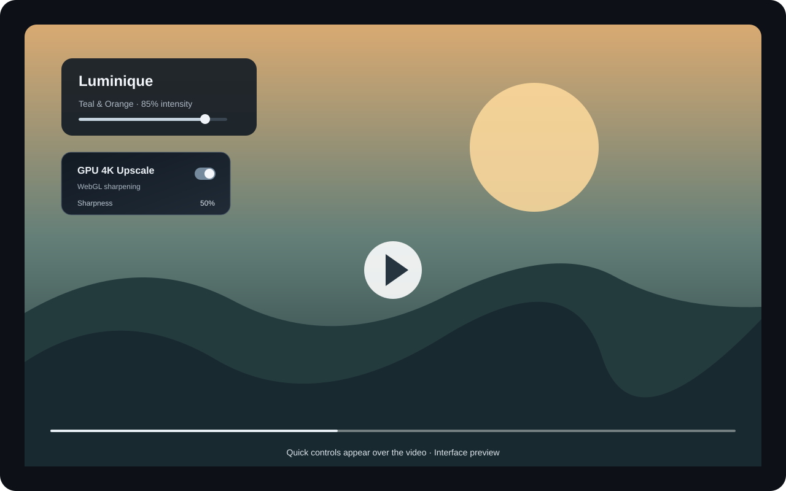

# Luminique

**Cinematic color filters and GPU-assisted video enhancement for Chrome.**

Luminique lets you apply film-inspired color looks to videos across websites, adjust filter intensity, and optionally use GPU/WebGL upscaling with sharpening. Its compact on-video panel provides quick controls, and preferences are remembered separately for each site. The interface supports English and Turkish.

> Created with the help of AI tools and refined by its creator.

## Features

- Film, cinema, HDR, retro, color, and black-and-white presets
- Adjustable filter intensity
- Optional WebGL/Lanczos upscale and sharpness control
- On-video controls
- Per-site preferences stored locally in Chrome
- English and Turkish interface

## Interface previews

| Filter controls | Video controls |
| --- | --- |
|  |  |

These are interface preview images prepared from the extension UI for this repository.

## Install locally

1. Download or clone this repository.
2. Open chrome://extensions in Chrome.
3. Turn on Developer mode.
4. Choose Load unpacked and select this folder.

## Permissions and privacy

Luminique uses Chrome storage to remember the selected language and per-site filter settings. It uses scripting to apply its controls to videos. The current source does not include analytics, account sign-in, or a remote data collection endpoint. See [Privacy](PRIVACY.md) for details.

The extension requests access to pages so it can find and enhance videos on those pages. Chrome's built-in pages do not allow extensions to run.

## Built with AI assistance

AI tools assisted with development. The feature design, source, and final project are maintained by the creator.

## License

No open-source license has been added yet. Unless a license is added, reuse and redistribution are not granted by this repository.
